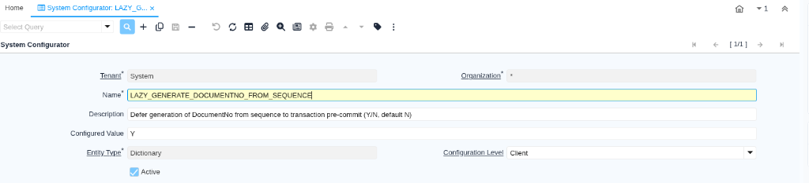
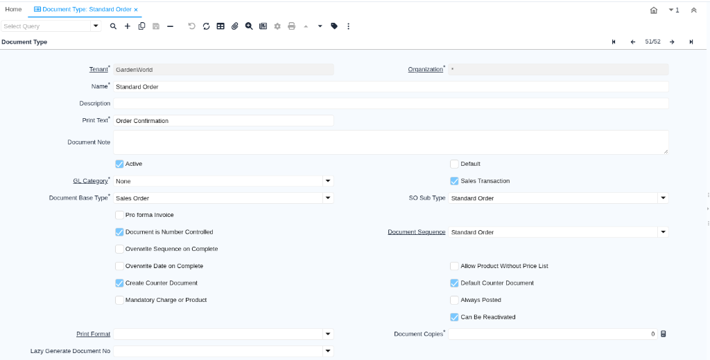

# Lazy generate document numbers from sequence

:::warning Not Yet in Stable Release

This feature is not yet part of a stable iDempiere release and may change.

:::

**Goal:** Technical  
**Developer:** [Heng Sin Low](https://github.com/hengsin)  
**Feature Ticket:** [IDEMPIERE-7185](https://idempiere.atlassian.net/browse/IDEMPIERE-7185)  
**Version:** iDempiere 14

## The problem

When creating documents such as sales orders, purchase orders, invoices, material receipts, shipments, or payments, iDempiere traditionally generates the document number from the sequence table (`AD_Sequence`) as soon as the header record is first saved.

Updating the sequence row acquires an exclusive row lock on that sequence record. Because this lock occurs at the beginning of document creation, the transaction holds the lock across its entire lifecycle. This includes creating line items, calculating taxes, updating storage reservations, running workflows, and executing business logic.

Under high-volume workloads or concurrent transactions (such as web store integrations, EDI processing, or point-of-sale checkouts), threads queue up waiting for the sequence lock. When lock contention exceeds the timeout specified by `MSEQUENCE_GETNEXT_TIMEOUT` (default 30 seconds), transactions fail with a `GenerateDocumentNoTimeOut` error.

## What changed

This feature introduces lazy generation of document numbers from sequences:

- When a new document record is saved, iDempiere assigns a temporary document number instead of querying and locking `AD_Sequence`. The temporary number uses the prefix `@TMP-` followed by a base64-encoded UUIDv7, which fits within standard 30-character document number columns.
- Generation of the actual document number from `AD_Sequence` is deferred until:
  1. The transaction pre-commit phase (`beforeCommit` transaction event), or
  2. Business logic explicitly reads the document number via `getDocumentNo()`.
- The duration of the sequence lock is shortened to the brief moment just before database commit, minimizing lock contention among concurrent transactions.
- If a transaction rolls back before commit, the temporary document number is discarded and the sequence record is never queried or updated. This avoids burning sequence numbers or blocking other transactions.
- When the sequence generates the actual document number, related records created earlier in the transaction that captured the temporary number are updated automatically:
  - `AD_ChangeLog`: The insert change log entry for the `DocumentNo` column is updated to record the actual document number.
  - `M_StorageReservationLog`: Storage reservation log entries recorded during order or receipt processing are updated with the actual document number.

## How to set it up

Lazy document number generation can be enabled tenant-wide, or configured individually for specific document types.

### Configure tenant-wide lazy generation

To enable lazy document number generation across an entire Tenant:

1. Open the System Configurator window as a System Administrator or Tenant Administrator.
2. Search for the `LAZY_GENERATE_DOCUMENTNO_FROM_SEQUENCE` configuration key.
3. Set the **Configured Value** to `Y`.
4. Save the record and reset the cache.

### Configure per Document Type

You can override or configure lazy generation on specific Document Types:

1. Open the Document Type window.
2. Select the Document Type record (such as "Standard Order").
3. Verify that **Document is Number Controlled** is checked and **Overwrite Sequence on Complete** is unchecked.
4. Set the **Lazy Generate Document No** field:
   - Leave empty (null) to follow the tenant-level `LAZY_GENERATE_DOCUMENTNO_FROM_SEQUENCE` configuration.
   - Select `Yes` to enable lazy generation for this document type, even if the tenant setting is `N`.
   - Select `No` to disable lazy generation for this document type, even if the tenant setting is `Y`.
5. Save the record.

## Configuration

| System Configurator key | Default | Level | What it does |
| --- | --- | --- | --- |
| `LAZY_GENERATE_DOCUMENTNO_FROM_SEQUENCE` | `N` | Client | Defers generation of `DocumentNo` from sequence to transaction pre-commit when set to `Y`. |

### Precedence and bypass rules

- **Document Type override:** Setting **Lazy Generate Document No** on a Document Type explicitly to `Yes` or `No` takes precedence over `LAZY_GENERATE_DOCUMENTNO_FROM_SEQUENCE`.
- **Overwrite Sequence on Complete:** If **Overwrite Sequence on Complete** (`IsOverwriteSeqOnComplete`) is checked on the Document Type, lazy generation is bypassed. The initial save uses immediate numbering or temporary numbering according to sequence rules, and the final sequence number is assigned when the document is completed.
- **Not number controlled:** If **Document is Number Controlled** (`IsDocNoControlled`) is unchecked, no document sequence is used.
- **Definite sequence requests:** When code explicitly requests a definitive document number (`definite=true`) or when SQL logging scripts are generated (`isLogSQLScript()`), lazy generation is bypassed.
- **UUID Sequence:** If a Document Type is using a **UUID Sequence**, lazy generation is bypassed.

## Technical notes

For core and plugin developers:

- **Temporary DocumentNo format:** Formatted as `MSequence.TEMP_DOCUMENTNO_PREFIX` (`@TMP-`) concatenated with a 22-character URL-safe Base64 representation of a 16-byte UUIDv7.
- **`MSequence` helper methods:**
  - `MSequence.isTemporaryDocumentNo(String documentNo)`: Returns `true` if the string starts with `@TMP-`.
  - `MSequence.isUsingTemporaryDocumentNo(PO po)`: Checks whether a persistent object holds a pending temporary document number.
  - `MSequence.getDocumentNo(int C_DocType_ID, String trxName, boolean definite, PO po, boolean deferToPreCommit)`: Overloaded method that accepts `deferToPreCommit`.
  - `MSequence.getDocumentNo(int AD_Client_ID, String TableName, String trxName, PO po, boolean deferToPreCommit)`: Overloaded method for table-level sequences.
- **`PO` methods:**
  - `po.is_UsingTemporaryDocumentNo()`: Checks if the current `PO` instance holds a temporary document number.
  - `po.get_TemporaryDocumentNo()`: Returns the temporary document number without triggering sequence generation.
  - `po.addDeferredDocumentNoCallback((tempDocNo, actualDocNo) -> ...)`: Registers a callback invoked when the actual document number is generated.
  - Calling `po.getDocumentNo()` or `po.get_Value("DocumentNo")` triggers sequence generation immediately if deferred generation is still pending.
- **Transaction pre-commit event:**
  - `Trx` fires `beforeCommit(Trx trx)` on all registered `TrxEventListener` listeners prior to committing the database connection.
  - If a `beforeCommit` listener throws an exception, the transaction is safely rolled back.

## Migration impact

None. This feature is disabled by default (`LAZY_GENERATE_DOCUMENTNO_FROM_SEQUENCE` defaults to `N` and `C_DocType.IsLazyGenerateDocNo` defaults to `null`). Existing installations continue generating document numbers immediately unless the feature is explicitly enabled.

## Related tickets

- [IDEMPIERE-7185](https://idempiere.atlassian.net/browse/IDEMPIERE-7185)
- [IDEMPIERE-7120](https://idempiere.atlassian.net/browse/IDEMPIERE-7120)
